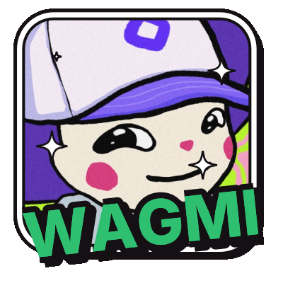
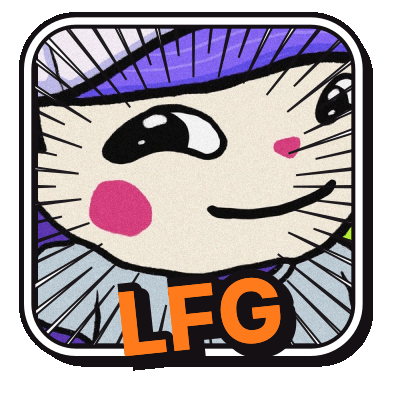
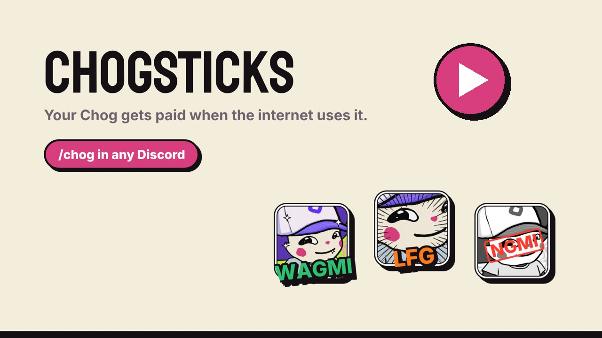
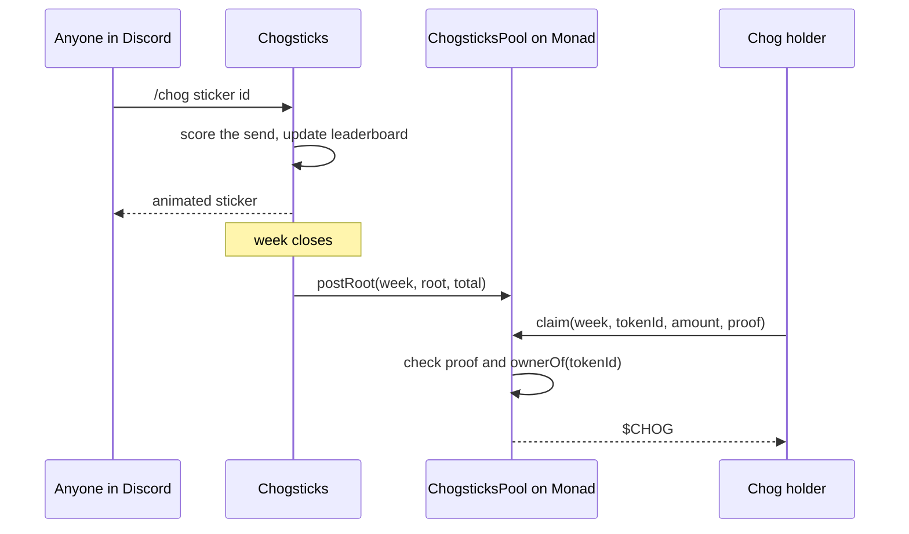
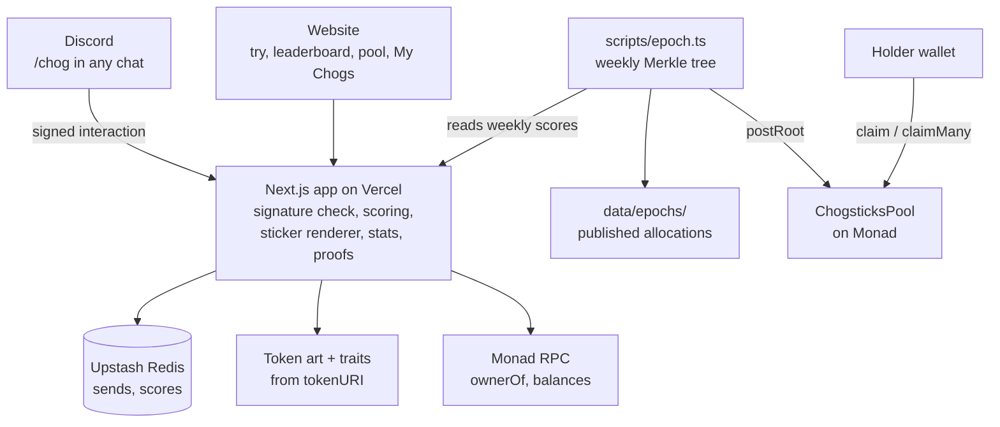

<p align="center">
  
  
  
</p>

# Chogsticks

[](https://github.com/mystiquemide/chogsticks/actions/workflows/ci.yml)

**Your Chog gets paid when the internet uses it.**

Every Chog Genesis NFT is an animated sticker pack made from its own on-chain art. Anyone can send it in Discord with `/chog`. Each send is credited to that token, and every week the wallet holding the Chog claims its share of a $CHOG pool on Monad.

[chogsticks.midelabs.xyz](https://chogsticks.midelabs.xyz) · [Try a sticker pack](https://chogsticks.midelabs.xyz/try) · [Add to Discord](https://discord.com/oauth2/authorize?client_id=1561422294574694420) · [Leaderboard](https://chogsticks.midelabs.xyz/leaderboard) · [Pool](https://chogsticks.midelabs.xyz/pool)

[](https://youtu.be/mdepgrYxjeI)

## Contents

- [Why](#why)
- [Try it in 2 minutes](#try-it-in-2-minutes)
- [How it works](#how-it-works)
- [The sticker packs](#the-sticker-packs)
- [How sends are scored](#how-sends-are-scored)
- [Weekly payouts](#weekly-payouts)
- [Why the token has to be there](#why-the-token-has-to-be-there)
- [Keeping it fair](#keeping-it-fair)
- [On-chain](#on-chain)
- [Architecture](#architecture)
- [Compared to](#compared-to)
- [Limitations](#limitations)
- [Run locally](#run-locally)

## Why

PFP art gets passed around chats all day as memes and reaction images. Pudgy Penguins GIFs have [tens of billions of GIPHY views](https://research.4pillars.io/en/research/pudgy-penguins-will-inherit-disneys-crown), and the people holding those NFTs earn nothing from any of it. An NFT only pays its holder when it sells.

Chogsticks turns use into income. The more people reach for your Chog in chat, the more it earns, and the earnings stay attached to the token.

## Try it in 2 minutes

**In the browser, nothing to install**

1. Open [/try](https://chogsticks.midelabs.xyz/try), type any id from 1 to 1969 or hit Random.
2. Flip through that Chog's pack. Copy the `/chog` command, copy the GIF link, or download it.

**In Discord**

1. [Add Chogsticks to your account](https://discord.com/oauth2/authorize?client_id=1561422294574694420) and choose **Add to My Apps**. No server admin needed.
2. In any server, DM or group chat, type `/chog`, pick a sticker, and give an id. Leave the id empty for a random Chog.
3. The animated sticker posts. Its footer says whether the send was credited, and if not, why.
4. Click **Whose Chog is #…?** under the sticker. The token page shows the new send, its rank, its 7-day chart, and the wallet earning from it.

**If you hold a Chog**

Open [My Chogs](https://chogsticks.midelabs.xyz/my), paste your wallet or tap Use my wallet. You see every Chog you hold, its sends and rank, this week's estimate, and one Claim all button for every posted payout.

Then check the [leaderboard](https://chogsticks.midelabs.xyz/leaderboard) and the [pool](https://chogsticks.midelabs.xyz/pool).

## How it works

| Step | What happens |
|---|---|
| **Send** | `/chog sticker:lfg id:21` in any chat. Chog #21's animated LFG sticker posts. |
| **Count** | The send is credited to token #21. Different people count fully, repeats from one person fade, and fresh alt accounts earn nothing. |
| **Settle** | Each week the scores become a Merkle root posted to the pool contract on Monad. The full allocation file is published in this repo. |
| **Claim** | Whoever holds #21 at claim time collects its $CHOG from the token page. Sell the Chog and its unclaimed and future earnings go to the buyer. |

## The sticker packs

Every Chog gets 6 base stickers, plus up to 3 more picked from its traits. Each sticker is the token's untouched art with motion and a caption on top, rendered as a 12-frame animated GIF.

**Base stickers, every Chog**

| Sticker | Motion |
|---|---|
| GM | spin |
| WAGMI | bounce |
| NGMI | slam |
| COPE | wobble |
| LFG | punch |
| CHOG ON | strobe |

**Trait stickers**

| Trait | Sticker |
|---|---|
| Eyes: BTC | NUMBER GO UP |
| Eyes: laser | LASER EYES |
| Eyes: dead | I'M DEAD |
| Eyes: heart | LOVE THIS |
| Eyes: crying or tears | SAD BOI |
| Eyes: side eye | SIDE EYE |
| Mouth: rainbow puke | SICK |
| Mouth: drool | WANT |
| Mouth: gold tooth | RICH |
| Accessory: green candle | PUMP IT |
| Accessory: red candle | DUMP IT |
| Accessory: knife | STABBY |
| Head: crown | KING |
| Head: wizard hat | MAGIC |
| Tier: legendary | LEGENDARY |

Traits are read from each token's metadata at its on-chain `tokenURI`, so 1,969 tokens give 1,969 different packs.

## How sends are scored

Every send is counted as raw usage. Only some sends are credited toward payouts.

| Rule | Detail |
|---|---|
| Decay per sender | The 1st send from one person to one Chog in a day scores 1, then 0.5, 0.25, 0.125, 0.0625 |
| Daily cap | After 5 sends to the same Chog in a day, that person's sends score 0 until the next UTC day |
| Different people | Each new sender starts again at full weight |
| Account age | Discord accounts younger than 30 days are counted but not credited. Age is read from the Discord user id |
| Replays | The same Discord interaction is only counted once |

A Chog's weekly score is the sum of its credited sends. Its share of the week's budget is its score divided by the total score of all Chogs that week. Each week's budget is half of the pool's unallocated balance, so the pool shrinks gradually and never empties in one week.

## Weekly payouts

1. **Week closes.** Week 1 ran from Oct 19 to Oct 23 08:00 UTC. Every week after runs 7 days from there.
2. **Allocation is built.** `scripts/epoch.ts` reads the week's scores, splits the budget by score, and builds an OpenZeppelin Merkle tree of `(week, tokenId, amount)`.
3. **File is published.** The full allocation, with every token, score, amount and proof, is written to [`data/epochs/`](data/epochs) so anyone can recompute the root.
4. **Root is posted.** The poster wallet calls `postRoot(week, root, total)` on the pool. The contract refuses if `total` is more than the unallocated balance.
5. **Holder claims.** On the token page or My Chogs, the holder connects a wallet and claims. The contract checks the proof and that the caller is `ownerOf(tokenId)` right now, then sends the $CHOG.



## Why the token has to be there

- **The pack is the token.** Stickers are rendered from that token's own image and traits, read from its on-chain `tokenURI`.
- **The payee is the token.** Sends are credited to a token id. The contract pays `ownerOf(tokenId)` at claim time and checks it on-chain.
- **The income moves with the token.** Transfer the Chog and the next claim goes to the new holder.

## Keeping it fair

| Attempt | Result | Proof |
|---|---|---|
| One account spams a Chog 10 times | Scores 1 + 0.5 + 0.25 + 0.125 + 0.0625, then 0 for the rest of the day | [`tests/scoring.test.ts`](tests/scoring.test.ts) |
| Fresh alt accounts | Discord accounts younger than 30 days are counted but not credited | [`tests/scoring.test.ts`](tests/scoring.test.ts) |
| Replaying a Discord interaction | Ignored, counted once | [`tests/scoring.test.ts`](tests/scoring.test.ts) |
| Forged request to the bot endpoint | Rejected, Ed25519 signature check runs before anything is read | [`app/api/discord/route.ts`](app/api/discord/route.ts) |
| Claiming twice, claiming a token you don't hold, inflating the amount, using another token's proof | Reverts | [`contracts/test/ChogsticksPool.t.sol`](contracts/test/ChogsticksPool.t.sol) |
| Posting more than the pool holds, or one week draining another | Reverts | [`contracts/test/ChogsticksPool.t.sol`](contracts/test/ChogsticksPool.t.sol) |
| The operator withdrawing the pool | There is no withdraw function | [`contracts/src/ChogsticksPool.sol`](contracts/src/ChogsticksPool.sol) |

10 scoring tests (`npm test`) and 16 contract tests including a fuzz test (`forge test`) cover these cases. CI runs both, plus the type check, lint and build, on every push.

## On-chain

Monad mainnet, chain id 143.

| | Address |
|---|---|
| ChogsticksPool | [`0x430dAd64ADF435D9aD6AbCc42340483ec4ad3d04`](https://monadscan.com/address/0x430dAd64ADF435D9aD6AbCc42340483ec4ad3d04), source [verified on Sourcify](https://repo.sourcify.dev/143/0x430dAd64ADF435D9aD6AbCc42340483ec4ad3d04) (exact match) |
| Chog Genesis | [`0xc96d31F8626c6D03Fae5dCD3d61e3FB9F4a73763`](https://monadscan.com/address/0xc96d31F8626c6D03Fae5dCD3d61e3FB9F4a73763) |
| $CHOG | [`0x350035555E10d9AfAF1566AaebfCeD5BA6C27777`](https://monadscan.com/address/0x350035555E10d9AfAF1566AaebfCeD5BA6C27777) |

| Event | Transaction |
|---|---|
| Pool deployed | [`0x5fffe1cd…b85d`](https://monadscan.com/tx/0x5fffe1cd8d22f7979b8e33ce23fadb108b86426657b56099d96e36e83215b85d) |
| Bought $CHOG on nad.fun | [`0x9a16a8c5…3438`](https://monadscan.com/tx/0x9a16a8c54576be462c06b6e36a5934b1dea4b93cd7abe2b0b3f83b13c9c63438) |
| Funded the pool with 51.58 $CHOG | [`0x38f76345…fa56`](https://monadscan.com/tx/0x38f7634596195918a9cbd70c896a8633962bee53ed57b9abc1936b69e1b1fa56) |

**Pool contract functions**

| Function | Who | What it does |
|---|---|---|
| `fund(amount)` | Anyone | Adds $CHOG to the pool |
| `postRoot(week, root, total)` | Poster only | Posts a week's Merkle root, once per week, never more than the unallocated balance |
| `claim(week, tokenId, amount, proof)` | Current holder | Pays that token's share to `ownerOf(tokenId)` |
| `claimMany(items)` | Current holder | Claims several weeks or tokens in one transaction |
| `unallocated()` | Anyone | Pool balance not yet promised to any week |

## Architecture



| Part | Where | What it does |
|---|---|---|
| Discord endpoint | [`app/api/discord/route.ts`](app/api/discord/route.ts) | Verifies the signature, handles `/chog` and autocomplete, records the send, replies with the sticker |
| Sticker renderer | [`lib/stickers.ts`](lib/stickers.ts) | Picks each token's pack and renders animated GIFs and PNGs from its art |
| Scoring | [`lib/scoring.ts`](lib/scoring.ts) | Decay, daily cap, account age, replay protection, weekly epochs |
| Stats | [`lib/stats.ts`](lib/stats.ts) | Leaderboards, per-token stats, the homepage counters |
| Pool reads | [`lib/pool.ts`](lib/pool.ts) | Balances, posted roots, claim status, `ownerOf` |
| Holdings | [`lib/holdings.ts`](lib/holdings.ts) | Finds a wallet's Chogs, their estimates and unclaimed payouts for My Chogs |
| Payout script | [`scripts/epoch.ts`](scripts/epoch.ts) | Builds the week's Merkle tree and allocation file |
| Contract | [`contracts/src/ChogsticksPool.sol`](contracts/src/ChogsticksPool.sol) | Holds $CHOG, stores roots, pays the current holder |

**Public API**

| Endpoint | Returns |
|---|---|
| `GET /api/sticker/{id}/{name}.gif` | Animated sticker, for example [`/api/sticker/21/wagmi.gif`](https://chogsticks.midelabs.xyz/api/sticker/21/wagmi.gif) |
| `GET /api/sticker/{id}/{name}.png` | Still sticker |
| `GET /api/stickers/{id}` | A token's full pack with URLs |
| `GET /api/proof/{week}/{id}` | A token's claim amount and Merkle proof for a posted week |
| `GET /api/health` | Store health check |

## Compared to

| | What it does | Difference |
|---|---|---|
| Server stickers and emojis | A handful of mascot images, locked to one server unless you pay for Nitro | 1,969 per-token packs that work in any server or DM, and every send pays a holder |
| GIPHY / Tenor brand channels | Spreads the brand's art | Spreads each holder's own Chog and routes the value back to them |
| NFT licensing programs | Holders apply for brand deals | Income from everyday use, no application, settled weekly on-chain |
| Telegram collectible stickers | You own a sticker | You own the character, and others using it is what pays you |

## Limitations

- **The contract is unaudited.** It is small and covered by 16 Foundry tests, but no third party has reviewed it.
- **Counting happens off-chain.** Sends are scored on the Chogsticks server and settled weekly. The poster wallet (`0x460a…5c6F`) decides each week's root. It cannot withdraw funds or post more than the pool holds, and each allocation is published for anyone to check.
- **Holders can still send their own Chog.** It is capped at 5 decaying sends a day like anyone else. Blocking it fully needs Discord-to-wallet linking, which is not built yet.
- **Unclaimed $CHOG stays in the pool.** There is no withdraw path, by design, so nothing can be pulled back out.
- **Discord only for now.** The Telegram and X paths are not built.
- **The pool is small.** It was seeded with 51.58 $CHOG. Anyone can top it up with `fund()`.
- **Week 1 was shortened.** It closed on Oct 23 at 08:00 UTC for the launch payout.

Everything on the live site is real. Sends and scores come from Redis, and balances, roots and claims come from Monad. Nothing is mocked.

## Run locally

```bash
git clone https://github.com/mystiquemide/chogsticks && cd chogsticks
npm install
cp .env.example .env.local
npm test && (cd contracts && forge test)
npm run dev
```

| Variable | Needed for |
|---|---|
| `CHOGSTICKS_Application_ID`, `CHOGSTICKS_Public_Key` | Discord endpoint and install link |
| `CHOGSTICKS_BOT_TOKEN` | Registering the `/chog` command (`scripts/register-commands.ts`) |
| `KV_REST_API_URL`, `KV_REST_API_TOKEN` | Upstash Redis. Optional, counts fall back to memory |
| `MONAD_RPC_URL` | Chain reads, defaults to `https://rpc.monad.xyz` |

The contract tests need `forge-std` in `contracts/lib` (`git clone https://github.com/foundry-rs/forge-std contracts/lib/forge-std`).

Next.js 16 on Vercel, Upstash Redis, `sharp` for rendering, viem for Monad, Solidity 0.8.24 with Foundry and OpenZeppelin, and OpenZeppelin's Merkle tree library for payouts.

## License

MIT
